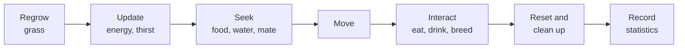

# Agent-based predator–prey simulation (C++)

> UCL MSc coursework (COMP0210, April 2026). The repository is private because it
> answers assessed questions, so this page describes the design rather than
> publishing the code. I started from a course template that provided the grid
> skeleton, CMake files and a plotting script, and wrote the rest myself.

## What it is

Rabbits and foxes live on a 2D grid of grass, water, bushes and bare ground.
Each animal tracks its energy, thirst and drive to mate, and looks for food,
water or a partner accordingly. Offspring inherit six genetic traits from their
parents, with mutation, so the population's traits drift over time. The program
records population counts and trait statistics to CSV.

It runs in three modes: serial, multithreaded with OpenMP, and distributed over
4 MPI processes.

## Stack

C++17 · CMake · OpenMP · MPI (OpenMPI) · Catch2 · Python and matplotlib for plots

## How it works

Each timestep runs the same sequence of steps:

- `Animal` is an abstract base class holding the shared state and genetic traits.
  `Rabbit` and `Fox` implement their own seek, move and interact behaviour
- The grid keeps a registry of which animals are on which tile, so an animal
  can search its surroundings within a radius instead of scanning every animal
- Rabbits that see a fox run to the nearest bush and stay there, or move away if
  no bush is in range. Foxes can't see into or enter bushes. A rabbit that is
  starving or very thirsty ignores the fox and goes for food or water instead

## Parallelising it

**OpenMP.** Not every step is safe to run in parallel. Update, seek and reset only
read shared state or write to the animal itself, so those loops run across
threads, with dynamic scheduling for seek because search cost varies a lot
between animals. Move and interact write to the shared tile registry and add
newborn animals to the population, so they stay serial rather than adding locks.

**MPI.** The grid is split into a 2×2 block, one quarter per process. That raises
three problems, each handled at a fixed point in the timestep:

1. *Animals near an edge can't see across it.* Before seek, every animal within
   15 tiles of a boundary (the largest sense radius) is copied to the
   neighbouring process as a read-only "ghost" with `MPI_Sendrecv`. Ghosts are
   removed once seek is done.
2. *Animals that move change owner.* After move, animals that crossed into
   another quarter are packed into a plain struct and sent to their new owner
   with `MPI_Alltoall` (to share how many) and `MPI_Alltoallv` (to send them).
3. *Grass eaten in one quarter has to disappear everywhere.* After interact,
   every process shares its list of eaten tiles with `MPI_Allgatherv`.

For output, each process sends counts, trait sums and sums of squares to rank 0
with `MPI_Reduce`, which turns them into global means and standard deviations
without collecting every animal in one place.

To make this possible, I first split the serial loop into separate step methods
that the distributed version overrides, so the serial and MPI versions share
the same animal logic.

## Testing

22 Catch2 test cases covering grass regrowth, water placement, radius search,
rabbit and fox behaviour, breeding, and the scared/hiding logic.

## Limitations

- The MPI version only supports exactly 4 processes in a 2×2 layout
- I didn't measure speed-up for the OpenMP or MPI versions, so I can't say how
  well either scales

---

[martinchaouk@gmail.com](mailto:martinchaouk@gmail.com) ·
[LinkedIn](https://www.linkedin.com/in/martin-chao-782348235/)
